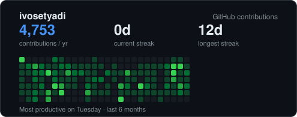

# 📈 Heatmap+

A **richer GitHub contribution card** as an embeddable SVG — total contributions, current & longest streak, busiest weekday, and a mini heatmap. Drop it in any README.

Part of [DevGuard Tools](https://ivosetyadi.github.io). **No API token required** — it reads the public contributions calendar. Use it two ways:

- **Hosted (Worker):** embed a live URL — always fresh, zero setup.
- **GitHub Action:** generate the SVG on a schedule and commit it into your repo — no hosting, fully self-contained.

## Option A — Hosted URL (Cloudflare Worker)

```markdown

```

### Themes

```markdown


```

| Param | Default | Values |
|-------|---------|--------|
| `user` | _(required)_ | any GitHub username |
| `theme` | `light` | `light` \| `dark` \| `dracula` |

## What it shows

- **Total contributions** in the last year
- **Current streak** and **longest streak** (consecutive active days)
- **Most productive weekday**
- A compact 6-month heatmap

Cards are edge-cached for 2 hours.

## Option B — GitHub Action (commit an SVG, no hosting)

Runs on a schedule, renders the card, and commits `heatmap.svg` to your repo. Reference that file in your profile README.

```yaml
# .github/workflows/heatmap.yml
name: Heatmap+
on:
  schedule: [{ cron: '0 3 * * *' }]   # daily
  workflow_dispatch:
permissions:
  contents: write
jobs:
  render:
    runs-on: ubuntu-latest
    steps:
      - uses: actions/checkout@v4
      - uses: ivosetyadi/heatmap-plus@v1
        with:
          theme: dark          # user defaults to the repo owner
          output: heatmap.svg
          commit: true
```

Then in your README:

```markdown

```

| Input | Default | Description |
|-------|---------|-------------|
| `user` | repo owner | GitHub username |
| `theme` | `light` | `light` \| `dark` \| `dracula` |
| `output` | `heatmap.svg` | file path to write |
| `commit` | `true` | commit & push if changed |
| `commit-message` | `chore: update contribution heatmap [skip ci]` | — |

## How it works

The Worker fetches `github.com/users/<user>/contributions` (public, unauthenticated), parses the day cells, computes the stats, and renders an SVG. The parsing, stats, and rendering are pure functions — see `test/run.mjs` (15 assertions, no network).

## Develop

```bash
npm test                               # unit tests (offline)
node test/live.mjs ivosetyadi dark out.svg   # render a real card
npm run deploy                         # wrangler deploy (needs Cloudflare auth)
```

## License

MIT © Ivo Setyadi
